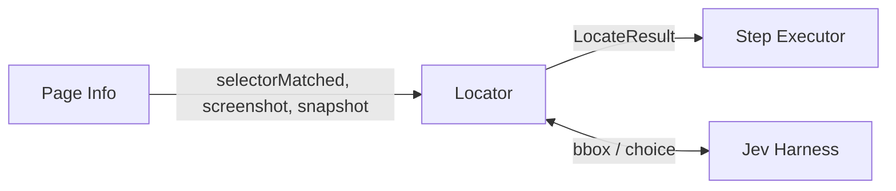
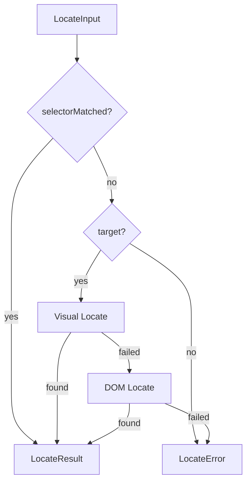
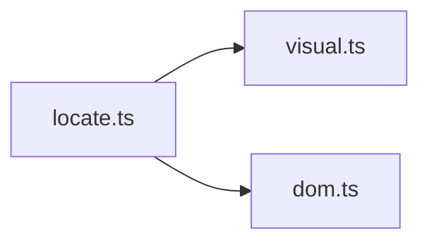

# Element Locator

The Element Locator decides which page element a step refers to. It receives the page data captured by Page Info (a screenshot and an element snapshot) and returns the chosen element's id. It does not use Playwright, never performs the action itself, and never modifies the test file.

## 1. Functional Definition

### 1.1 Scope

The Locator is used only by the element interaction actions defined in the Syntax Analyzer doc (1.2): `click`, `doubleClick`, `rightClick`, `hover`, and `input`. It reads the step's `selector` and `target` fields, which the Syntax Analyzer has already validated (at least one is present).

Page-level actions (`open`, `back`, `press`, ...), `waitFor`, and `assert` do not go through the Locator. It runs once per element step, right after Page Info has captured the current page (see 1.3), because the page changes after every action.

### 1.2 Locating Strategy

There are three stages, always tried in this order:

| Stage         | Method name | Input                                   | Succeeds when |
| ------------- | ----------- | --------------------------------------- | ------------- |
| Selector      | `selector`  | `selectorMatched` from Page Info        | Page Info found a visible element for `selector` |
| Visual Locate | `visual`    | `target` + screenshot + snapshot        | Jev returns a bounding box with confidence ≥ threshold, and the box center falls on a snapshot element |
| DOM Locate    | `dom`       | `target` + snapshot                     | Jev chooses a candidate with confidence ≥ threshold |

Which stages run depends on the fields present, matching the Syntax Analyzer doc (1.1):

| Fields                | Stages run | Selector timeout (applied by Page Info) |
| --------------------- | ---------- | ---------------------- |
| `selector` only       | Selector. On failure the step fails; Jev is never called | `timeoutMs` |
| `target` only         | Visual → DOM | – |
| `selector` + `target` | Selector → Visual → DOM | `SELECTOR_PROBE_MS` (2000 ms) |

A later stage runs only if the previous one failed. The first stage that succeeds ends the process.

### 1.3 Input from Page Info

Page Info (`core/src/core/page-info/`, separate design doc) runs before the Locator for every element step:

1. If `selector` is present, wait for `page.locator(selector).first()` to become visible, with the timeout from the table in 1.2, and set `selectorMatched`. If several elements match, the first one is used; this is not an error.
2. If the selector did not match and `target` is present, capture the viewport screenshot and the element snapshot. Otherwise nothing is captured, so a selector hit costs no screenshot.
3. Call `locate()` with the result.

The snapshot uses the same format as the integration fixtures (`src/tests/integration/hw3/README.md`): every visible interactive element inside the viewport, in DOM order, marked in the page with `data-jev-id`. The Locator reads these fields of each element:

| Field      | Use |
| ---------- | --- |
| `id`       | The value returned to the Step Executor |
| `role`, `name`, `text`, `attrs` | DOM Locate description lines; `role` and `attrs.disabled` also decide editability |
| `bbox`     | Matching the Visual Locate box center |
| `hittable` | Elements covered by something else (e.g. a modal backdrop) are skipped |

All coordinates are CSS pixels relative to the viewport, so screenshot pixels and `bbox` values share one coordinate system. The snapshot's `texts` list is not used by the Locator.

### 1.4 Visual Locate

1. Ask Jev for a bounding box on the screenshot (see 3.2) with the question:
   `Find the element described as: "<target>". Return its bounding box.`
2. The stage fails if Jev returns no box or a confidence below `CONFIDENCE_THRESHOLD`.
3. Compute the box center and find the snapshot elements whose `bbox` contains it, keeping only usable elements (see 1.5, step 1).
4. If several elements contain the point (e.g. a button inside a clickable card), choose the one with the smallest area.
5. The stage fails if no element contains the point. Otherwise it returns that element's `id`.

This is pure geometry on the snapshot; no browser call is made. Targets that are not interactive, such as an alert message or a canvas chart, are not in the snapshot and cannot be returned, which is fine because they are never the target of an interaction step.

### 1.5 DOM Locate

1. Build the candidate list from the snapshot elements that are usable for the action:
   - `hittable` is `true` and `attrs.disabled` is not set;
   - for the `input` action, only editable elements: `role` is `textbox` or `searchbox`.
2. Keep at most `MAX_DOM_CANDIDATES` (50) candidates, in snapshot order.
3. Build one description line per candidate from `role`, `name`, `text`, and the `type`, `placeholder`, and `checked` attributes, truncating text to `MAX_TEXT_LENGTH` (50) characters and omitting empty fields:
```text
   textbox "Email" type=email placeholder="you@example.com"
   button "Show password"
   checkbox "Remember me" checked=false
```
4. The stage fails if there are no candidates.
5. Ask Jev to choose one line (see 3.2) with the question:
   `Which element best matches the description: "<target>"?`
6. The stage fails if Jev returns no choice, an index out of range, or a confidence below `CONFIDENCE_THRESHOLD`. Otherwise it returns the chosen candidate's `id`.

Known limitation: identical elements, such as six "Delete task" buttons in different table rows, produce identical lines, so DOM Locate cannot tell them apart. Visual Locate usually can, because it sees the row around the button. Adding nearby text to each line is left as a later accuracy improvement (PRD 4.3.9).

### 1.6 Constants

| Constant               | Value | Description |
| ---------------------- | ----- | ----------- |
| `CONFIDENCE_THRESHOLD` | `0.7` | Minimum Jev confidence for Visual and DOM Locate |
| `MAX_DOM_CANDIDATES`   | `50`  | Maximum candidates sent to Jev |
| `MAX_TEXT_LENGTH`      | `50`  | Maximum characters of text per candidate line |

All constants live in `constants.ts`. `SELECTOR_PROBE_MS` and the `data-jev-id` marking belong to Page Info.

### 1.7 Failure

If every stage that ran has failed, `locate()` throws a `LocateError` containing one attempt record per stage, for example:

```text
Could not locate "Sign in button":
  selector "#login" — no visible match
  visual — confidence 0.42 below 0.7
  dom — Jev chose no candidate
```

The Locator does not retry. Retrying a failed Jev request is handled inside the Jev Harness. Taking the failure screenshot and marking the step as `failed` are handled by the execution pipeline.

## 2. Internal Flow

Where the Locator sits in one element step:



Inside the Locator:



1. If `selectorMatched` is true, return a `selector` result without calling Jev.
2. If there is no `target`, throw `LocateError`.
3. Run Visual Locate, then DOM Locate if needed.
4. Record every attempt (method, success, duration, confidence, reason).
5. Return a `LocateResult` for the first success, or throw `LocateError`.

## 3. External Interface

### 3.1 Function

```ts
function locate(input: LocateInput, jev: JevClient): Promise<LocateResult>;

type LocateInput = {
  action: "click" | "doubleClick" | "rightClick" | "hover" | "input";
  selector?: string; // from Step
  target?: string; // from Step
  selectorMatched: boolean; // set by Page Info; false when there is no selector
  screenshot?: Buffer; // PNG; required when selectorMatched is false and target is present
  snapshot?: PageSnapshot; // same condition as screenshot
};

type LocateMethod = "selector" | "visual" | "dom";

type LocateAttempt = {
  method: LocateMethod;
  ok: boolean;
  durationMs: number;
  confidence?: number; // Visual and DOM only
  reason?: string; // present when ok is false
};

type LocateResult = {
  method: LocateMethod; // the stage that succeeded
  elementId?: number; // snapshot element id; present for visual and dom
  confidence?: number; // Visual and DOM only
  durationMs: number; // total time of all attempts
  attempts: LocateAttempt[];
};

class LocateError extends Error {
  attempts: LocateAttempt[];
}
```

`PageSnapshot` is defined by Page Info and mirrors `snapshot.json` (see 1.3). Missing `screenshot` or `snapshot` when they are required is a programming error and throws immediately.

The Step Executor turns the result into a Playwright locator:

```ts
const locator =
  result.method === "selector"
    ? page.locator(step.selector!).first()
    : page.locator(`[data-jev-id="${result.elementId}"]`);
await locator.fill(step.value);
```

In the diagram this is `Locator.getElementKey()`: the "element key" is `elementId`. `method`, `confidence`, and `durationMs` are passed on to the report, e.g. the CLI line `click "Sign In button" [visual, conf=0.92] (1420ms)`.

### 3.2 Jev Harness Interface (Assumed)

> **Assumed interface.** `JevClient` is implemented by the Jev Harness, which calls the real Jev model through OpenRouter. The Harness design doc has not been written yet; this interface will be aligned with it.

```ts
type BoundingBox = { x: number; y: number; width: number; height: number }; // pixels of the image

interface JevClient {
  // CSS pixels of the screenshot, same as snapshot bbox
  bbox(question: string, image: Buffer): Promise<{ box: BoundingBox | null; confidence: number }>;

  // DOM Locate: choose one option; index is into options, null if none fits.
  choice(question: string, options: string[]): Promise<{ index: number | null; confidence: number }>;
}
```

Assumptions:

- Box coordinates are in pixels of the image sent. If Jev returns 0–1 normalized coordinates, the Harness converts them before returning.
- The Harness handles retries. If Jev still fails, it throws, and the Locator records that stage as failed with the error message.
- `jev` is passed in as a parameter, so tests can use a fake `JevClient`.

## 4. Class Architecture

### 4.1 Modules



| Module         | Responsibility |
| -------------- | -------------- |
| `locate.ts`    | Entry point `locate()`: decides which stages run, records attempts, returns `LocateResult` or throws `LocateError` |
| `visual.ts`    | Visual Locate (1.4): Jev `bbox`, box center, element at point |
| `dom.ts`       | DOM Locate (1.5): usable candidates, description lines, Jev `choice` |
| `constants.ts` | Constants in 1.6 |

None of these modules imports Playwright. To add a new stage, add a module and call it from `locate.ts` in the desired order.

### 4.2 Directory Layout

```text
core/src/core/locator/
├── index.ts       # exports locate, LocateError and types
├── types.ts       # LocateInput, LocateResult, LocateAttempt, JevClient
├── constants.ts
├── locate.ts
├── visual.ts
└── dom.ts
```

## 5. Test Plan

All tests use Vitest and never launch a browser. The fake `JevClient` is used only in automated tests; the product always calls the real Jev.

| Type        | Coverage | Location |
| ----------- | -------- | -------- |
| Unit        | Description lines (truncation, omitted fields); element at point (inside, smallest area, `hittable: false` skipped, editable filter for `input`) | `core/test/locator/dom.test.ts`, `visual.test.ts` |
| Unit        | `locate()` flow: `selectorMatched` never calls Jev, order Visual → DOM, `LocateError` lists every attempt, missing page data throws | `core/test/locator/locate.test.ts` |
| Integration | For every target in the hw3 fixtures: a fake Jev returning the ground-truth `bbox` makes Visual Locate return the expected `elementId`; a fake Jev choosing the ground-truth element does the same for DOM Locate; targets with `present: false` or `elementId: null` end in `LocateError` | `core/test/locator/fixtures.test.ts`, reading `src/tests/integration/hw3/fixtures/` |
| Manual      | The same fixtures with the real Jev through OpenRouter, to measure accuracy; not run in CI | Benchmark Test Suite |
