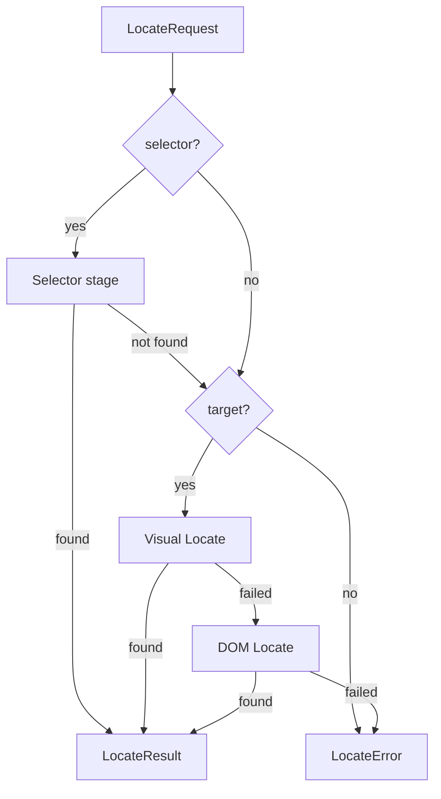
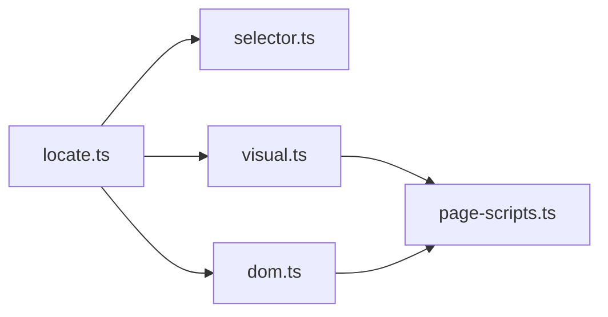

# Element Locator

The Element Locator finds the page element that a step refers to and returns it as a Playwright `Locator` for the Step Executor (Playwright APIs) to act on. It never performs the action itself and never modifies the test file.

## 1. Functional Definition

### 1.1 Scope

The Locator is used only by the element interaction actions defined in the Syntax Analyzer doc (1.2): `click`, `doubleClick`, `rightClick`, `hover`, and `input`. It reads the step's `selector` and `target` fields, which the Syntax Analyzer has already validated (at least one is present).

Page-level actions (`open`, `back`, `press`, ...), `waitFor`, and `assert` do not go through the Locator.

### 1.2 Locating Strategy

There are three stages, always tried in this order:

| Stage         | Method name | Input                     | Succeeds when |
| ------------- | ----------- | ------------------------- | ------------- |
| Selector      | `selector`  | `selector`                | The first matching element becomes visible within the stage timeout |
| Visual Locate | `visual`    | `target` + screenshot     | Jev returns a bounding box with confidence ≥ threshold, and an element exists at its center point |
| DOM Locate    | `dom`       | `target` + candidate list | Jev chooses a candidate with confidence ≥ threshold |

Which stages run depends on the fields present, matching the Syntax Analyzer doc (1.1):

| Fields                | Stages run | Selector stage timeout |
| --------------------- | ---------- | ---------------------- |
| `selector` only       | Selector. On failure the step fails; Jev is never called | `timeoutMs` |
| `target` only         | Visual → DOM | – |
| `selector` + `target` | Selector → Visual → DOM | `SELECTOR_PROBE_MS` (2000 ms) |

A later stage runs only if the previous one failed. The first stage that succeeds ends the process.

### 1.3 Selector Stage

1. Build `page.locator(selector).first()`. If the selector matches several elements, the first one in page order is used; this is not an error.
2. Call `waitFor({ state: "visible", timeout })` with the timeout from the table in 1.2. The short probe when `target` is also present avoids waiting the full step timeout for a selector that has become outdated.
3. If the wait times out, or Playwright rejects the selector string as invalid, the stage fails and the reason is recorded.

### 1.4 Visual Locate

1. Take a screenshot of the current viewport with `page.screenshot({ scale: "css" })`, so that one image pixel equals one CSS pixel. Only the visible part of the page is captured; elements outside the viewport can only be found by DOM Locate, or by adding a `scroll` step before.
2. Ask Jev for a bounding box (see 3.2) with the question:
   `Find the element described as: "<target>". Return its bounding box.`
3. The stage fails if Jev returns no box or a confidence below `CONFIDENCE_THRESHOLD`.
4. Compute the box center and run a browser-side script that:
   - gets the element at that point with `document.elementFromPoint(x, y)`;
   - moves up to the closest interactive ancestor (same element list as 1.5), because the point often lands on a `<span>` or icon inside a button; if there is none, keeps the element itself;
   - for the `input` action, fails if the result is not editable (see 1.5);
   - marks the element with the attribute `data-jevwright-id`.
5. The stage fails if no element was found. Otherwise the result is `page.locator('[data-jevwright-id="<id>"]')`.

The marking attribute is how a point on a screenshot is turned into a real Playwright `Locator`, so that `fill()` and `hover()` work the same as with a selector.

### 1.5 DOM Locate

1. Run a browser-side script that collects candidate elements in page order:
   - **Interactive elements**: `a[href]`, `button`, `input` (not `type=hidden`), `select`, `textarea`, `[contenteditable]`, and elements with `role` of `button`, `link`, `checkbox`, `radio`, `tab`, or `menuitem`.
   - **Editable elements** (used instead of the list above for the `input` action): `textarea`, `[contenteditable]`, and `input` whose type is text-like (`text`, `email`, `password`, `search`, `tel`, `url`, `number`, or no type).
   - Only visible elements are kept: non-zero size, and not `display: none` or `visibility: hidden`.
   - At most `MAX_DOM_CANDIDATES` (50) elements are kept. Each is marked with `data-jevwright-id`.
2. Build one description line per candidate from its tag and attributes, truncating text to `MAX_TEXT_LENGTH` (50) characters and omitting empty fields:
   ```text
   button text="Sign in"
   input type=email placeholder="Email address" name=email
   a text="Forgot password?" aria-label="Reset password"
   ```
3. The stage fails if there are no candidates.
4. Ask Jev to choose one of the lines (see 3.2) with the question:
   `Which element best matches the description: "<target>"?`
5. The stage fails if Jev returns no choice, an index out of range, or a confidence below `CONFIDENCE_THRESHOLD`. Otherwise the result is the `Locator` for the chosen candidate's `data-jevwright-id`.

### 1.6 Constants

| Constant               | Value               | Description |
| ---------------------- | ------------------- | ----------- |
| `SELECTOR_PROBE_MS`    | `2000`              | Selector stage timeout when `target` is also present |
| `CONFIDENCE_THRESHOLD` | `0.7`               | Minimum Jev confidence for Visual and DOM Locate |
| `MAX_DOM_CANDIDATES`   | `50`                | Maximum candidates sent to Jev |
| `MAX_TEXT_LENGTH`      | `50`                | Maximum characters of text per candidate line |
| `MARK_ATTRIBUTE`       | `data-jevwright-id` | Attribute used to mark found elements |

All constants live in `constants.ts`. Existing marks are removed at the start of each `locate()` call so the page is not filled with old attributes.

### 1.7 Failure

If every stage that ran has failed, `locate()` throws a `LocateError` containing one attempt record per stage, for example:

```text
Could not locate "Sign in button":
  selector "#login" — not visible within 2000 ms
  visual — confidence 0.42 below 0.7
  dom — Jev chose no candidate
```

The Locator does not retry. Retrying a failed Jev request is handled inside the Jev Harness. Taking the failure screenshot and marking the step as `failed` are handled by the execution pipeline.

## 2. Internal Flow



1. Clear old marks from the page.
2. If `selector` is present, run the Selector stage.
3. If not yet found and `target` is present, run Visual Locate, then DOM Locate if needed.
4. Record every attempt (method, success, duration, confidence, reason).
5. Return a `LocateResult` for the first success, or throw `LocateError`.

## 3. External Interface

### 3.1 Function

```ts
import type { Page, Locator } from "playwright";

function locate(page: Page, request: LocateRequest, jev: JevClient): Promise<LocateResult>;

type LocateRequest = {
  action: "click" | "doubleClick" | "rightClick" | "hover" | "input";
  selector?: string; // from Step
  target?: string; // from Step
  timeoutMs: number; // TestCase.timeoutMs
};

type LocateMethod = "selector" | "visual" | "dom";

type LocateAttempt = {
  method: LocateMethod;
  ok: boolean;
  durationMs: number;
  confidence?: number; // Visual and DOM only
  reason?: string; // present when ok is false
};

type LocateResult = {
  locator: Locator;
  method: LocateMethod; // the stage that succeeded
  confidence?: number; // Visual and DOM only
  durationMs: number; // total time of all attempts
  attempts: LocateAttempt[];
};

class LocateError extends Error {
  attempts: LocateAttempt[];
}
```

`LocateRequest` is filled directly from a `Step` produced by the Syntax Analyzer. Example use in the Step Executor:

```ts
const { locator } = await locate(
  page,
  { action: step.action, selector: step.selector, target: step.target, timeoutMs: testCase.timeoutMs },
  jev,
);
await locator.fill(step.value);
```

`method`, `confidence`, and `durationMs` are passed on to the report, e.g. the CLI line `click "Sign In button" [visual, conf=0.92] (1420ms)`.

### 3.2 Jev Harness Interface (Assumed)

> **Assumed interface.** The Jev Harness design doc has not been written yet. The Locator depends only on the interface below; it will be aligned with the Harness doc once that exists.

```ts
type BoundingBox = { x: number; y: number; width: number; height: number }; // pixels of the image

interface JevClient {
  // Visual Locate: find the described element in an image.
  bbox(question: string, image: Buffer): Promise<{ box: BoundingBox | null; confidence: number }>;

  // DOM Locate: choose one option; index is into options, null if none fits.
  choice(question: string, options: string[]): Promise<{ index: number | null; confidence: number }>;
}
```

Assumptions:

- Box coordinates are in pixels of the image sent. If Jev returns 0–1 normalized coordinates, the Harness converts them before returning.
- The Harness handles retries. If Jev still fails, it throws, and the Locator records that stage as failed with the error message.
- `jev` is passed in as a parameter, so tests can use a fake `JevClient`.

## 4. Class Architecture

### 4.1 Modules



| Module            | Responsibility |
| ----------------- | -------------- |
| `locate.ts`       | Entry point `locate()`: clears marks, decides which stages run, records attempts, returns `LocateResult` or throws `LocateError` |
| `selector.ts`     | Selector stage (1.3) |
| `visual.ts`       | Visual Locate (1.4): screenshot, Jev `bbox`, center point |
| `dom.ts`          | DOM Locate (1.5): candidate description lines, Jev `choice` |
| `page-scripts.ts` | Functions that run inside the browser via `page.evaluate()`: element at point, collect candidates, mark and clear marks |
| `constants.ts`    | Constants in 1.6 and the interactive / editable element lists |

To add a new stage, add a module and call it from `locate.ts` in the desired order.

### 4.2 Directory Layout

```text
core/src/core/locator/
├── index.ts         # exports locate, LocateError and types
├── types.ts         # LocateRequest, LocateResult, LocateAttempt, JevClient
├── constants.ts
├── locate.ts
├── selector.ts
├── visual.ts
├── dom.ts
└── page-scripts.ts
```

## 5. Test Plan

All tests use Vitest. Integration tests run real headless Chromium against local HTML loaded with `page.setContent()` and a fake `JevClient` that returns scripted answers and counts calls. No real Jev calls are made in these tests; real accuracy is measured by the Benchmark Test Suite.

| Type        | Coverage | Location |
| ----------- | -------- | -------- |
| Unit        | Candidate description lines (truncation, omitted fields), box center calculation | `core/test/locator/dom.test.ts`, `visual.test.ts` |
| Integration | Selector stage: match, multiple matches use first, no match, invalid selector, probe timeout when `target` is present | `core/test/locator/selector.test.ts` |
| Integration | Visual Locate: success, confidence below threshold, no element at point, point on a child `<span>` resolves to its button, `input` on a non-editable element fails | `core/test/locator/visual.test.ts` |
| Integration | DOM Locate: success, no candidates, index out of range, `input` keeps only editable candidates, cap of 50 | `core/test/locator/dom.test.ts` |
| Integration | `locate()` flow: `selector` only never calls Jev, fallback order Selector → Visual → DOM, `LocateError` lists every attempt | `core/test/locator/locate.test.ts` |

HTML fixtures live in `core/test/locator/fixtures/`, e.g. `login-form.html`, `nested-button.html`, `many-buttons.html`.
